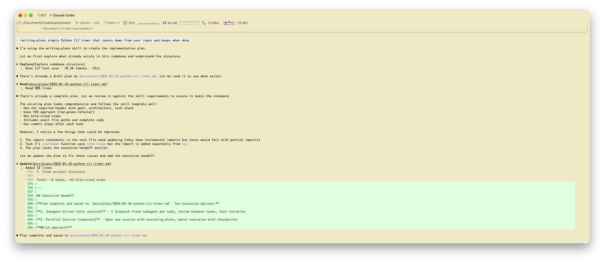
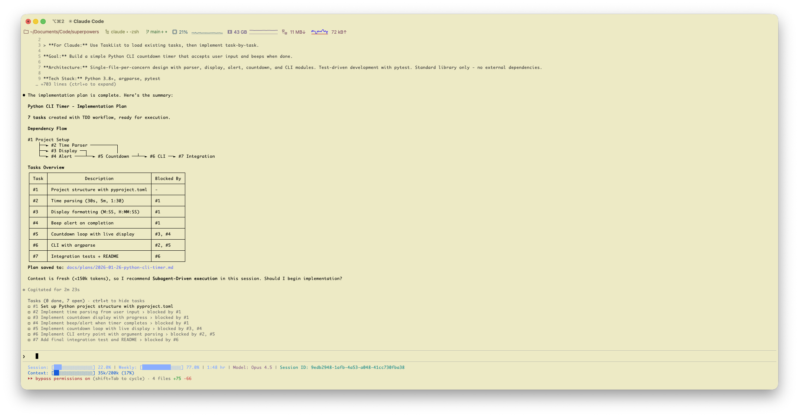
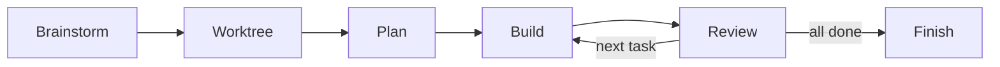

<div align="center">

# Superpowers Extended for Claude Code

### Superpowers plans that run on Claude Code's own tasks, so the agent works through the plan in order instead of skipping ahead.

A community-maintained fork of [obra/superpowers](https://github.com/obra/superpowers), built for Claude Code only.

[](https://github.com/pcvelz/superpowers/releases)
[](LICENSE)


**[Quick Install](#quick-install) · [Basic Workflow](#the-basic-workflow) · [Compared](#superpowers--extended-for-claude-code) · [Optional Flows](#user-gate-enforcement-optional) · [Skills](#skills-library) · [Recommended Hooks](#recommended-configuration) · [Dev Channel](#updating-development-channel)**

</div>

---

Superpowers gives your coding agent a way of working: brainstorm the design, write a plan, then build it task by task with tests and review. This fork keeps that workflow and runs it on Claude Code's own tools. Plan tasks become native tasks with dependencies, so a task stays blocked until the one before it is done, and you can watch what is pending, running and finished while Claude works. Everything else is opt-in: gates that make Claude re-check work you asked it to verify, cheaper models for simple plan tasks, and one commit per plan instead of one per task.

## Why This Fork Exists

The original Superpowers works across several AI coding tools (Claude Code, Codex, OpenCode, Gemini CLI), so features that only Claude Code has are out of its scope ([upstream discussion](https://github.com/obra/superpowers/pull/344#issuecomment-3795515617)). This fork is for people who use Claude Code and want those features:

- **Built on Claude Code's own tools.** Tasks, subagents and questions use Claude Code's built-in features, and new ones are adopted as they ship.
- **Same workflow as upstream.** Upstream releases get merged in, so the brainstorm, plan, build flow stays compatible with obra/superpowers.
- **Off until you turn it on.** Each optional feature is switched on by one file or hook. Without it, the plugin acts as if the feature is not there.
- **Open to contributions.** Any enhancement specific to Claude Code is welcome.

## Superpowers / Extended for Claude Code

The same plan, run on plain Superpowers and on this fork.

<table>
<tr>
<th>Superpowers</th>
<th>Extended for Claude Code</th>
</tr>
<tr>
<td valign="top"></td>
<td valign="top"></td>
</tr>
</table>

| | Superpowers | Extended for Claude Code |
|---|---|---|
| **Plan** | Only a markdown file; nothing tracks which step Claude is on | Every plan step is a native task. Claude works from the task list, not from its memory of the plan. |
| **Visibility** | You cannot see which task is running | Each task shows as pending, in progress or done. |
| **Order** | Claude can jump ahead or skip a task | Task 2 shows as blocked until Task 1 is done; the opt-in [task order](#enforce-blockedby-ordering-on-in_progress) hook makes Claude respect it. |
| **Progress** | You follow progress by reading the output | `TaskList` shows what is done, blocked and next, and a new session can pick up from there. |

## What It Adds

Native tasks need one setting on current Claude Code. Everything else is opt-in and does nothing until you switch it on.

| Area | What it does |
|---------|-------------|
| **Native tasks** | Plan tasks become Claude Code tasks with `blockedBy` dependencies, so you see pending, running and done while Claude works. Needs `CLAUDE_CODE_ENABLE_TODO_TOOLS` on Claude Code 2.1.233+, see [Manual Setup](#manual-setup). |
| **Structured tasks** | Every task carries its goal, files, acceptance criteria and verify step, plus a `json:metadata` block that hooks can read. See [How Native Tasks Work](#how-native-tasks-work). |
| **Commit gate** (opt-in) | Blocks `git commit` while a task is still in progress. See [Block Commits With Incomplete Tasks](#block-commits-with-incomplete-tasks). |
| **User gates** (opt-in) | Tag a task `userGate` and Claude cannot close it without checking again. See [User Gate Enforcement](#user-gate-enforcement-optional). |
| **"Plan complete" check** (opt-in) | Claude cannot stop on "plan complete" until it shows proof for each closed user gate. See [Re-Validate Gates on "Plan Complete" Claims](#re-validate-gates-on-plan-complete-claims). |
| **Task order** (opt-in) | Claude cannot start a task while the tasks it depends on are still open. See [Enforce blockedBy Ordering](#enforce-blockedby-ordering-on-in_progress). |
| **Dispatch check** (opt-in) | Blocks a subagent dispatch that does not use the model or agent type the task asks for. See [Enforce per-task LLM/dispatch requirements](#enforce-per-task-llmdispatch-requirements). |
| **Subagent evidence** (opt-in) | Sends a subagent back when its report lacks the evidence the task requires. See [Force Subagent Evidence on Return](#force-subagent-evidence-on-return). |
| **Low-context stop guard** (opt-in) | Blocks "context is full, continue in a fresh session" excuses while context use is below 50%. See [Block Low-Context Stop Excuses](#block-low-context-stop-excuses). |
| **Wait guard** (opt-in) | During plan execution, Claude cannot end a turn on "waiting for X" while a task is still in progress; the hook puts that task back in front of it. See [Plan-Execution Wait Guard](#plan-execution-wait-guard). |
| **Model routing** (opt-in) | Each plan task gets a tier (`mechanical`, `standard`, `frontier`), and simple tasks run on cheaper subagent models. Claude also cannot skip the question of how to run the plan. See [Subagent Model Routing](#subagent-model-routing-optional). |
| **Commit strategy** (opt-in) | A `workflow.json` file switches from one commit per task to one commit when the plan ends. See [Commit Strategy](#commit-strategy). |
| **Visual companion** (opt-in) | Brainstorming offers browser mockups and diagrams whenever the design involves a screen or layout. See [Visual Companion](#visual-companion). |
| **Hook trace log** | The user-gate hooks log every decision to one file, so you can see why something was blocked. See [Hook trace log](#hook-trace-log). |

The quickest setup is `/superpowers-extended-cc:onboard` (step 3 of [Quick Install](#quick-install)). It switches on native tasks, model routing, user gates, the wait guard and the commit strategy. The other hooks are one copy-paste block each in [Recommended Configuration](#recommended-configuration).

## Quick Install

```bash
# 1. Register the marketplace
/plugin marketplace add pcvelz/superpowers

# 2. Install the plugin
/plugin install superpowers-extended-cc@superpowers-extended-cc-marketplace

# 3. Recommended: enable auto-update (/plugin → Marketplaces tab), enable native tasks and optional features
/superpowers-extended-cc:onboard
```

Step 3 turns the native task tools back on (required on Claude Code 2.1.233+), can enable marketplace auto-update, and walks you through the optional features (model routing, user gates, wait guard, commit strategy). One scope choice, this project or all projects, governs every write.

> [!TIP]
> Already have the original Superpowers installed? `/superpowers-extended-cc:onboard` offers to upgrade you to Superpowers Extended for Claude Code directly.

You can also install straight from the repository URL: `/plugin install --source url https://github.com/pcvelz/superpowers.git`. Both routes give you the stable channel; for the latest beta, see [Development Channel](#updating-development-channel).

### Manual Setup

Everything `/superpowers-extended-cc:onboard` configures can also be set up by hand. The one required step:

**Turn the task tools back on (Claude Code 2.1.233+).** Add this to `~/.claude/settings.json` for all projects, or to `<project>/.claude/settings.json` for one:

```json
{"env": {"CLAUDE_CODE_ENABLE_TODO_TOOLS": "1"}}
```

Each optional feature has its own section below, listed in [What It Adds](#what-it-adds).

### Uninstall

```bash
# Removes the plugin together with its marketplace
/plugin marketplace remove superpowers-extended-cc-marketplace
```

Hooks you registered stay in your `settings.json`; remove the entries that point at `superpowers-extended-cc-marketplace`.

### Troubleshooting

If something is not working:

1. Run `/superpowers-extended-cc:diagnosing-superpowers` in the session that went wrong, or give it a past session's id. It explains what happened and can write it up as a bug report.
2. Open an issue on [GitHub](https://github.com/pcvelz/superpowers/issues) with that report.

## The Basic Workflow

Every piece of work goes through the same seven steps. Each step is a skill, and Claude starts it when it applies, so you do not have to call it yourself.



1. **brainstorming** starts before any code is written. It turns a rough idea into a design by asking questions and weighing alternatives, shows the design in sections for you to approve, and saves it.

2. **using-git-worktrees** starts once the design is approved. It creates a separate workspace on a new branch, runs the project setup, and checks that the tests pass before anything changes.

3. **writing-plans** breaks the approved design into small tasks of 2 to 5 minutes each, with exact file paths, complete code and a verify step. *Each task becomes a native task, with its dependencies.*

4. **subagent-driven-development** or **executing-plans** carries out the plan. The first sends each task to a fresh subagent and reviews it twice: does it match the spec, then is the code good. The second, the cheapest, does every task in the current session and reviews the whole branch once at the end. Both stop only at tasks the plan marks as user gates.

   **Architect pattern:** a plan executed in a separate session can ask the session that wrote it for help, over Claude Code's agent chat (`ListAgents` and `SendMessage`). The planning session answers design questions as the architect, while the executor keeps a focused context. This lets a long-running session hand off side work without losing what it knows.

5. **test-driven-development** runs during the build. Write a failing test, watch it fail, write the least code that passes, watch it pass, commit. Code written before its test gets deleted.

6. **requesting-code-review** runs between tasks. It checks the work against the plan and reports issues by severity; a critical issue stops progress until it is fixed.

7. **finishing-a-development-branch** runs when every task is done. It checks the tests, lets you choose to merge, open a PR, keep or discard the branch, and cleans up the worktree.

**Claude checks for a matching skill before every task.** These are workflows it must follow, not suggestions.

## How Native Tasks Work

`writing-plans` creates each task with four parts: a goal, the files to change, acceptance criteria and a verify command. Subagents and later sessions get the same four parts. A task looks like this:

```yaml
TaskCreate:
  subject: "Task 1: Add price validation to optimizer"
  description: |
    **Goal:** Validate input prices before optimization runs.

    **Files:**
    - Modify: `src/optimizer.py:45-60`
    - Create: `tests/test_price_validation.py`

    **Acceptance Criteria:**
    - [ ] Negative prices raise ValueError
    - [ ] Empty price list raises ValueError
    - [ ] Valid prices pass through unchanged

    **Verify:** `pytest tests/test_price_validation.py -v`

    ```json:metadata
    {"files": ["src/optimizer.py", "tests/test_price_validation.py"],
     "verifyCommand": "pytest tests/test_price_validation.py -v",
     "acceptanceCriteria": ["Negative prices raise ValueError",
       "Empty price list raises ValueError",
       "Valid prices pass through unchanged"]}
    ```
```

The `json:metadata` block is part of the description because `TaskGet` returns the description but not the `metadata` field. With the block in the description, these parts of the workflow can read it:

- **`executing-plans`** runs the verify command and checks each acceptance criterion.
- **`subagent-driven-development`** sends the full task, with its files and criteria, to the subagent.
- **`.tasks.json`** saves the plan, so a new session continues from the last finished task.
- **Opt-in hooks** read extra keys from the same block, such as a task's model tier or the evidence a subagent must report.

## User Gate Enforcement (optional)

*Full design: [`docs/user-gate-flow.md`](docs/user-gate-flow.md). This section is the short version.*

This flow addresses a recurring failure: you say "add a gate" or "verify it works" without saying **how**. Claude makes up a way to verify, finds it too much work when the task comes up, and closes the task with a shortcut instead. This flow stops that in three layers. It asks you nothing while the plan is written, and during execution it asks a question only when Claude cannot verify without your answer.

**The whole flow is opt-in.** It activates only when you register the hooks below in `.claude/settings.json`. Without the hooks, nothing calls `/superpowers-extended-cc:specify-gate`, so installing the plugin alone changes nothing.

### No questions while planning

A gate is a check you want done before the work moves on, in your own words: "verify it works first", "make sure the tests pass", "try it on one, then do all". When your request contains wording like that, `writing-plans` does not stop to ask how you want it checked; if you want questions, you say "brainstorm". Instead it uses the **strict definition** of a gate and tags every task that might be one. A task tagged by mistake costs a quick check during execution; an extra question costs you an interruption.

### The three layers

| Layer | When | What it does |
|-------|------|--------------|
| **`writing-plans` tags the task** | While the plan is written | Looks for gate words in your request ("verify", "prove", "gate", "first on one then all", "make sure", "don't proceed until") and tags that task with `userGate: true` and `tags: ["user-gate"]`. Asks you nothing. Gates you set, gates Claude sets and unclear cases all get tagged. |
| **Hooks check the close** | When a tagged task is closed, or Claude stops | The `PostToolUse` and `Stop` hooks fire. Claude has to check each acceptance criterion and take one of the paths below. |
| **`/superpowers-extended-cc:specify-gate` asks you** | During execution, only when Claude cannot verify without you | Asks you 4 questions to pin down the HOW: what you should see, how to prove it, what it covers, and what happens on failure. Claude then verifies from your answers. |

### What Claude does with a tagged task

When a tagged task comes up, Claude first answers one question: **do I know *how* to verify this?**

- **"Verify the `/health` endpoint returns 200"**: the HOW is clear. Claude calls the endpoint, saves the output and posts `AC: <criterion> — PROVEN BY <evidence>`. The hook sees the proof and lets the task close.
- **"Check it works"**: the HOW is unclear. Claude runs `/superpowers-extended-cc:specify-gate`, which asks you its 4 questions, and verifies based on your answers. It does not make up a method or take a shortcut.
- **The task has `requiresUserSpecification: true`**: same as above. `writing-plans` already marked the task as needing your answers.

So you get questions only in the last two cases: when Claude reaches a tagged task and neither the task nor the plan says how to verify it.

### Activation

Register the hooks in `.claude/settings.json`. The JSON is in [Force Re-Validation on User-Thrown Gate Close](#force-re-validation-on-user-thrown-gate-close) and [Re-Validate Gates on "Plan Complete" Claims](#re-validate-gates-on-plan-complete-claims), or run `/superpowers-extended-cc:onboard`. Without the hooks:
- `writing-plans` still tags gates. The tags are extra metadata and do nothing on their own.
- `/superpowers-extended-cc:specify-gate` is installed but never runs by itself.
- Nothing asks for proof when a task closes, the same as plain Superpowers.

You can register one hook or both. The `PostToolUse` hook checks each task as it closes; the `Stop` hook checks "everything done" claims at the end of a plan. Both can run in the same session.

### Turning it off for one session

If a hook hits an error, it lets the action through. To switch the hooks off for one session without editing settings, set `SUPERPOWERS_USERGATE_GUARD=0` or `SUPERPOWERS_USERGATE_STOP_GUARD=0`.

### Check that it works

Watch the trace log while a tagged task closes: `tail -F /tmp/claude-hooks/user-gate-trace.log`. [Hook trace log](#hook-trace-log) explains each line.

## Subagent Model Routing (optional)

*Full design: [`docs/model-routing-flow.md`](docs/model-routing-flow.md). This section is the short version.*

This flow addresses a cost problem that got worse with the most expensive models (Opus, Fable). `subagent-driven-development` starts three subagents per task, an implementer and two reviewers, plus more for fixes. By default every one of them runs on the session model. On a top-tier session, a ten-task plan means more than thirty top-tier subagents, while a cheaper model could do most of that work when the plan is written well. Prompt caching does not help here: it makes input cheaper, but most of the cost is the output each subagent writes. Routing lowers the price per token of those subagents. It does not set token budgets or spending limits.

**The whole flow is opt-in, with a single switch: `docs/superpowers/model-routing.json` in your project.** The hooks come with the plugin but do nothing until that file exists; without it, the plugin behaves exactly as without routing. There are no settings to edit and no hooks to register.

### How it works

Instructions in a skill are not enough, because Claude skips them when a session gets busy. So each of these four layers is a hook that Claude Code runs, not something Claude has to remember:

| Layer | When | What it does |
|-------|------|--------------|
| **Session notice** (`session-start` hook) | Session start | When the routing file exists, the tier rules and your mapping are added to the context, so Claude knows them from the first message. |
| **Plan gate** (`pre-taskcreate-model-tier` hook) | Every `TaskCreate` | Blocks a plan task without a valid `"modelTier"` in its `json:metadata` block. Once a plan skill has run in the session, this includes tasks that look like plan tasks but have no block at all. The block message contains the full tier table, so Claude can fix the task and create it again straight away. |
| **Dispatch gate** (`pre-agent-model-routing` hook) | Every `Agent` dispatch | While tasks with a tier are in progress, it allows their tier models and the `standard` model for reviewers. Anything else is blocked, with the correct model for each role in the message. A `"model"` set in a task's metadata overrides its tier, see [Enforce per-task LLM/dispatch requirements](#enforce-per-task-llmdispatch-requirements). |
| **Handoff guard** (`pre-askuser-handoff-guard` hook) | After `writing-plans` creates tasks | Allows an `AskUserQuestion` only if it offers the two required options ("Subagent-Driven (this session)" and "Parallel Session (separate)"), or has the word `CLARIFICATION` in the question. This stops Claude from asking its own question that skips the choice of how to run the plan. |

If one of the three gates hits an error, it lets the action through, so a broken file never blocks your session. `SUPERPOWERS_ROUTING_GUARD=0` turns all three off.

### The tiers

| Tier | Meaning |
|------|---------|
| `"mechanical"` | Changes 1 or 2 files, the steps contain the complete code, no design decisions. Most tasks in a well-written plan. |
| `"standard"` | Changes across several files, fitting parts together, following existing patterns, debugging. |
| `"frontier"` | Design and architecture decisions, or work that needs a broad view of the codebase. |

Tiers do not name models on purpose. A plan stays valid when new models come out; the routing file decides which model each tier uses today.

### Setup

Run `/superpowers-extended-cc:onboard` for a guided setup, or create the file by hand. Both give the same result.

Create `docs/superpowers/model-routing.json` in your project:

```json
{"mechanical": "haiku", "standard": "sonnet", "frontier": "inherit"}
```

- The keys are the three tiers. The values are the `model` values the Agent tool accepts (`haiku`, `sonnet`, `opus`, `fable`).
- `"inherit"` means that tier runs on the session model.
- Setting all three tiers to the same model runs every task on that model.
- Delete the file to switch routing off. The gates stop at once, and the tiers already in your tasks stay as metadata that does nothing.
- **Effort per tier:** an `"effort"` key sets the thinking effort for each tier, for example `{"mechanical": "low", "standard": "medium", "frontier": "inherit"}`. Without the key, Claude gets that same map as a recommendation. It is advice only unless you add `"enforceEffort": true`; the dispatch gate then checks effort through agent definitions that set it, and `/superpowers-extended-cc:onboard` writes those for you. See the [design doc](docs/model-routing-flow.md) for the details.
- **For all projects:** put the file at `~/.claude/superpowers/model-routing.json` instead. It applies to every project without its own file. The project file is checked first, then the user file, and the first one found is used as a whole; the two are not merged. To switch routing off in one project while a user file exists, give that project a file with `"inherit"` for all three tiers.

### Role assignments when routing is on

Implementers, and the subagents sent to fix their work, run at their task's tier. The spec and code-quality reviewers run at `standard`: checking work against written criteria does not need the top model, and reviews write a lot of output, which is the expensive part. The final review of the whole plan runs after every task is done. No task is in progress then, so the dispatch gate does not apply, and it should run on the session model: one top-tier review per plan. When an implementer reports BLOCKED and needs more reasoning, move the task one tier up and write that change into its metadata. Never move a task down without saying so.

## Workflow Configuration (optional)

*Full design: [`docs/workflow-config-flow.md`](docs/workflow-config-flow.md). This section is the short version.*

### Commit Strategy

By default, a plan commits once per task: every task ends with its own commit step, and implementer subagents commit their work before review. That stays the default and is recommended, because small commits give a detailed history and let you undo a single task. If you prefer to review one commit per plan, you can switch to committing at the end.

**The whole flow is opt-in, with a single switch: `docs/superpowers/workflow.json` in your project.** Without that file, or without the key, nothing changes.

```json
{"commitStrategy": "at-end"}
```

With `at-end` set, a notice at session start tells Claude to:

- write plans without a commit step per task;
- end every plan with one last task, "Commit the full implementation", which waits until all other tasks are done;
- tell implementer subagents not to commit. The main session makes the single commit in that last task, and reviewers read the uncommitted changes instead.

Details:

- Prefer a guided setup? Run `/superpowers-extended-cc:onboard`; it covers this feature alongside the other optional flows.
- Valid values are `"per-task"` (the default) and `"at-end"`; anything else falls back to per-task.
- **For all projects:** put the file at `~/.claude/superpowers/workflow.json` instead. It applies to every project without its own file. The project file is checked first, then the user file, and the first one found is used as a whole; the two are not merged. To keep per-task commits in one project while a user file exists, give that project `{"commitStrategy": "per-task"}`.
- While `at-end` is set, a hook blocks plan tasks that still contain a commit step. If the hook hits an error it lets the task through, and `SUPERPOWERS_WORKFLOW_GUARD=0` turns it off. What subagents are told not to commit is advice only, and a change to the file takes effect from the next session.
- To undo, delete the file or remove the `commitStrategy` key. Per-task commits return from the next session.

### Visual Companion

During brainstorming, Claude can show mockups and diagrams in your browser. By default it offers this only when something is clearer shown than told. To have it offered whenever the design involves a screen, layout, diagram or comparison, add this key to the same `workflow.json`:

```json
{"visualCompanion": "always"}
```

It uses the same project-then-user lookup. It is advice only; no hook enforces it. Remove the key to go back to the default.

Both keys go in one object when you use them together:

```json
{"commitStrategy": "at-end", "visualCompanion": "always"}
```

## What's Inside

### Skills Library

*Italic* text marks what this fork adds to a skill from upstream.

| Area | Skill | What it does |
|---|---|---|
| **Testing** | `test-driven-development` | Write a failing test, make it pass, then clean up. Includes a list of common testing mistakes. |
| **Debugging** | `systematic-debugging` | Finds the root cause in 4 phases before any fix. Includes techniques for tracing a cause back, adding checks at several layers, and waiting on conditions instead of fixed delays. |
| | `verification-before-completion` | Runs the check and shows the output before Claude says something is fixed or done. |
| **Collaboration** | `brainstorming` | Turns a rough idea into a design by asking questions, one at a time. *Creates native tasks.* |
| | `writing-plans` | Writes a detailed plan of small tasks. *Each task becomes a native task with its dependencies.* |
| | `executing-plans` | Runs the plan in the current session with one review at the end. *Can resume from native tasks and stops at user gates.* |
| | `subagent-driven-development` | Sends each task to a fresh subagent and reviews it twice: spec first, then code quality. |
| | `dispatching-parallel-agents` | Runs independent tasks in parallel subagents. |
| | `using-git-worktrees` | Creates a separate workspace on its own branch. |
| | `requesting-code-review` | Checks the work against the plan before it moves on. |
| | `receiving-code-review` | Checks review feedback before acting on it, instead of agreeing by reflex. |
| | `finishing-a-development-branch` | Checks the tests, then lets you merge, open a PR, keep or discard the branch. |
| **User gates** (optional) | `checking-gates` | Asks "do I know how to verify this?" for a user-gate task. If yes, it verifies and posts the proof; if not, it hands over to `specifying-gates`. |
| | `specifying-gates` | Asks you 4 short questions to pin down how a vague user gate should be verified. See [User Gate Enforcement](#user-gate-enforcement-optional). |
| **Meta** | `writing-skills` | Writes new skills and tests them before use. |
| | `using-superpowers` | Loads at session start and tells Claude how to find and use skills. |
| | `diagnosing-superpowers` | Explains why a session went wrong (repeated work, skipped plans, high cost) and can write it up as a bug report. |

### Commands

| Command | What it does |
|---|---|
| `/superpowers-extended-cc:onboard` | Guided setup: native tasks, the optional features and auto-update. See [Quick Install](#quick-install). |
| `/superpowers-extended-cc:gate-check` | Runs `checking-gates` on a user-gate task. Does nothing unless the user-gate hooks are registered. |
| `/superpowers-extended-cc:specify-gate` | Runs `specifying-gates` for a user-gate task whose verification is unclear. Does nothing unless the user-gate hooks are registered. |

## Philosophy

- **Test-Driven Development** - Write tests first, always
- **Systematic over ad-hoc** - Process over guessing
- **Complexity reduction** - Simplicity as primary goal
- **Evidence over claims** - Verify before declaring success

Read more: [Superpowers for Claude Code](https://blog.fsck.com/2025/10/09/superpowers/)

## Contributing

Contributions for Claude Code-specific enhancements are welcome!

1. Fork this repository
2. Create a branch for your enhancement
3. Follow the `writing-skills` skill for creating and testing new skills
4. Submit a PR

See `skills/writing-skills/SKILL.md` for the complete guide.

## Recommended Configuration

### Disable Auto Plan Mode

Claude Code may automatically enter Plan mode during planning tasks, which conflicts with the structured skill workflows in this plugin. To prevent this, add `EnterPlanMode` to your permission deny list.

**In your project's `.claude/settings.json`:**

```json
{
  "permissions": {
    "deny": ["EnterPlanMode"]
  }
}
```

This blocks the model from calling `EnterPlanMode`, ensuring the brainstorming and writing-plans skills operate correctly in normal mode. See [upstream discussion](https://github.com/anthropics/claude-code/issues/23384) for context.

### Block Commits With Incomplete Tasks

Optional `PreToolUse` hook that blocks `git commit` while a native task is `in_progress`. Pending tasks pass through, so per-task commit flows work as intended.

Opt in via `.claude/settings.json`:

```json
{
  "hooks": {
    "PreToolUse": [
      {
        "matcher": "Bash",
        "hooks": [
          {
            "type": "command",
            "command": "bash ~/.claude/plugins/marketplaces/superpowers-extended-cc-marketplace/hooks/examples/pre-commit-check-tasks.sh"
          }
        ]
      }
    ]
  }
}
```

See the header of `hooks/examples/pre-commit-check-tasks.sh` for how it parses the session transcript and which task states count as open.

### Force Re-Validation on User-Thrown Gate Close

Optional `PostToolUse` hook that blocks when Claude closes a **user-thrown gate** task without capturing concrete evidence for every acceptance criterion. A user-thrown gate is any task that carries `"userGate": true` or a `"user-gate"` entry in `tags` inside its `json:metadata` fence, set by `writing-plans` when the user explicitly asked for a verification step ("make sure to verify X", "add a gate", "prove it on one, then all").

Non-gate tasks pass through silently. The hook only fires when `TaskUpdate` sets status to `completed`.

Opt in via `.claude/settings.json`:

```json
{
  "hooks": {
    "PostToolUse": [
      {
        "matcher": "TaskUpdate",
        "hooks": [
          {
            "type": "command",
            "command": "bash ~/.claude/plugins/marketplaces/superpowers-extended-cc-marketplace/hooks/examples/post-task-complete-revalidate.sh"
          }
        ]
      }
    ]
  }
}
```

See the header of `hooks/examples/post-task-complete-revalidate.sh` for how it parses `json:metadata` and the `USER-ORDERED GATE` banner, and how the `SUPERPOWERS_USERGATE_GUARD=0` escape hatch works.

**You confirm the gate.** With the registration above, evidence Claude captured is enough to close a gate task. Register the same script under `PreToolUse` as well and a gate task cannot be closed until you answered after it went `in_progress`, through an `AskUserQuestion` or a typed message. Tasks without the gate tag close as usual. The onboard command offers this as "Yes, I confirm those".

```json
{
  "hooks": {
    "PreToolUse": [
      {
        "matcher": "TaskUpdate",
        "hooks": [
          {
            "type": "command",
            "command": "bash ~/.claude/plugins/marketplaces/superpowers-extended-cc-marketplace/hooks/examples/post-task-complete-revalidate.sh"
          }
        ]
      }
    ]
  }
}
```

### Re-Validate Gates on "Plan Complete" Claims

Optional `Stop` hook that complements the PostToolUse hook above. It fires when Claude signals plan completion ("plan complete", "both gates passed", "implementation complete", etc.) but the transcript shows user-thrown gate tasks were closed without subsequent per-criterion proof. Requires Claude to post evidence in the form `AC: <criterion> — PROVEN BY <evidence>` before it can stop.

Opt in via `.claude/settings.json`:

```json
{
  "hooks": {
    "Stop": [
      {
        "matcher": "",
        "hooks": [
          {
            "type": "command",
            "command": "bash ~/.claude/plugins/marketplaces/superpowers-extended-cc-marketplace/hooks/examples/stop-revalidate-user-gates.sh"
          }
        ]
      }
    ]
  }
}
```

See the header of `hooks/examples/stop-revalidate-user-gates.sh` for the full list of completion keywords and the `SUPERPOWERS_USERGATE_STOP_GUARD=0` escape hatch.

### Enforce blockedBy Ordering on in_progress

Optional `PreToolUse` hook on `TaskUpdate` that refuses to move a task into `status=in_progress` while its `blockedBy` list still points at tasks that are not yet `completed`. Motivation: observed failure mode where a coordinator jumps to a later task ("this one is simpler, zero setup") even though its declared prerequisites feed it. The plan meant V0.x to catalog state before V1.x replays consume it; without the catalog, the replay runs blind.

The hook does not silently refuse. Its stderr invites self-assessment first ("is this a hallucination, or did you already do this work informally?"), offers three escalation paths (do the blocker, cancel it if truly obsolete, or raise the ordering to the user with AskUserQuestion), and explicitly warns against the bypass move of closing the blocker with status=completed without doing the work.

Opt in via `.claude/settings.json`:

```json
{
  "hooks": {
    "PreToolUse": [
      {
        "matcher": "TaskUpdate",
        "hooks": [
          {
            "type": "command",
            "command": "bash ~/.claude/plugins/marketplaces/superpowers-extended-cc-marketplace/hooks/examples/pre-task-blockedby-enforce.sh"
          }
        ]
      }
    ]
  }
}
```

See the header of `hooks/examples/pre-task-blockedby-enforce.sh` for the transcript-walking logic and the `SUPERPOWERS_BLOCKEDBY_GUARD=0` escape hatch.

### Enforce per-task LLM/dispatch requirements

Optional `PreToolUse` hook on `Agent` that reads the currently in_progress task's `json:metadata` fence and refuses Agent calls that disagree with its `subagentType`, `model`, or `dispatchBrief`. Use when a plan's tasks are sensitive to which tier runs them: empirical measurements, coordinator-quality work, zero-cost batches.

If a task's metadata carries `{"model": "haiku"}` and the coordinator dispatches `model: "opus"`, this hook blocks the call with a stderr explaining the mismatch and three response options (retry with the required params, update metadata transparently, or escalate via AskUserQuestion).

When the task has no dispatch requirement in metadata, the hook passes silently.

Opt in via `.claude/settings.json`:

```json
{
  "hooks": {
    "PreToolUse": [
      {
        "matcher": "Agent",
        "hooks": [
          {
            "type": "command",
            "command": "bash ~/.claude/plugins/marketplaces/superpowers-extended-cc-marketplace/hooks/examples/pre-agent-task-dispatch-validate.sh"
          }
        ]
      }
    ]
  }
}
```

See the header of `hooks/examples/pre-agent-task-dispatch-validate.sh` for the transcript-walking logic and the `SUPERPOWERS_DISPATCH_GUARD=0` escape hatch. Metadata keys are documented in `skills/shared/task-format-reference.md`.

### Force Subagent Evidence on Return

Optional `PostToolUse` hook on `Agent` that fires the moment a subagent's `tool_result` arrives, before the coordinator absorbs it and reports upward. If the in_progress task carries `requireEvidenceTokens` (multi-axis evidence requirement) or the `requireABCompare: true` shortcut, the hook checks that the subagent's report contains at least one token from each axis. Missing axes → block with stderr naming them, forcing immediate re-dispatch rather than "looks good" at close time.

When the task has no evidence requirement in metadata, the hook passes silently.

Opt in via `.claude/settings.json`:

```json
{
  "hooks": {
    "PostToolUse": [
      {
        "matcher": "Agent",
        "hooks": [
          {
            "type": "command",
            "command": "bash ~/.claude/plugins/marketplaces/superpowers-extended-cc-marketplace/hooks/examples/post-agent-return-validate.sh"
          }
        ]
      }
    ]
  }
}
```

See the header of `hooks/examples/post-agent-return-validate.sh` for the metadata schema and the `SUPERPOWERS_AGENT_RETURN_GUARD=0` escape hatch.

### Hook trace log

All three user-gate hooks (post-complete revalidate, stop revalidate, pre-blockedby enforce) write one-line decision traces to `/tmp/claude-hooks/user-gate-trace.log` (override via `SUPERPOWERS_USERGATE_TRACE_LOG`). Tail during development with:

```
tail -F /tmp/claude-hooks/user-gate-trace.log
```

Each line is pipe-separated: `TIMESTAMP | hook-name | task=N | event | reason`. Events include `enter`, `skip`, `parsed`, `scanned`, `pass`, `block`, `error`. Skip reasons identify the short-circuit (e.g. `tool=Bash`, `status=pending`, `superpowers-active`, `guard=0`). This is the fastest way to see why a hook did or did not fire on a specific task.

### Block Low-Context Stop Excuses

Optional `Stop`-event hook that blocks "fresh session later" / "context is full" deflections when real context usage is below 50%.

Opt in via `.claude/settings.json`:

```json
{
  "hooks": {
    "Stop": [
      {
        "matcher": "",
        "hooks": [
          {
            "type": "command",
            "command": "bash ~/.claude/plugins/marketplaces/superpowers-extended-cc-marketplace/hooks/examples/stop-deflection-guard.sh"
          }
        ]
      }
    ]
  }
}
```

See the header of `hooks/examples/stop-deflection-guard.sh` for the full list of blocked phrases, configuration environment variables, and fail-open behavior.

### Plan-Execution Wait Guard

Optional `Stop` hook for `executing-plans`. Sometimes Claude ends a turn on a status line such as "waiting out the grace period" or "I'll continue once it reports", with no tool call and no question, while a plan task is still in progress. The session then sits idle until you type "ok". The hook quotes that sentence back and repeats the in-progress task as the plan wrote it. It only fires in sessions that ran `executing-plans`, and only once per stop.

Register it in `~/.claude/settings.json`, so parallel executor sessions inherit it, or in a project's `.claude/settings.json`:

```json
{
  "hooks": {
    "Stop": [
      {
        "matcher": "",
        "hooks": [
          {
            "type": "command",
            "command": "bash ~/.claude/plugins/marketplaces/superpowers-extended-cc-marketplace/hooks/examples/stop-wait-guard.sh"
          }
        ]
      }
    ]
  }
}
```

The header of `hooks/examples/stop-wait-guard.sh` explains exactly when it blocks.

## Updating: Development Channel

Skills update automatically when you update the plugin:

```bash
/plugin update superpowers-extended-cc@superpowers-extended-cc-marketplace
```

Besides [stable](#quick-install), the latest beta version (`dev` branch, `-dev` versions, still being tested):

```bash
# Removing the marketplace also uninstalls the plugin; your settings stay
/plugin marketplace remove superpowers-extended-cc-marketplace
/plugin marketplace add pcvelz/superpowers#dev
/plugin install superpowers-extended-cc@superpowers-extended-cc-marketplace

# Recommended: enable auto-update (/plugin → Marketplaces tab)
```

To return to stable, repeat with `pcvelz/superpowers` (without `#dev`).

## Upstream Compatibility

This fork tracks `obra/superpowers` main branch. Changes specific to Claude Code are additive - the core workflow remains compatible.

## License

MIT License - see LICENSE file for details

## Support

- **Issues**: https://github.com/pcvelz/superpowers/issues
- **Upstream**: https://github.com/obra/superpowers
